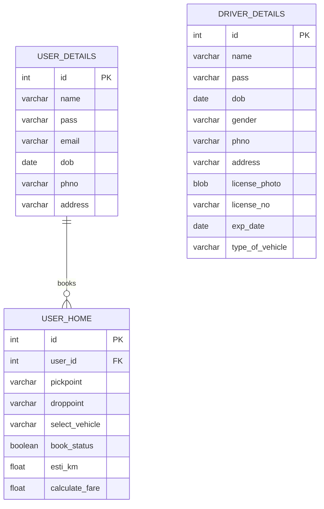

# 🚚 Porter Application

A Java-based console logistics and ride booking application inspired by **Porter**. The application allows users and drivers to register, authenticate, and manage ride bookings with automatic fare calculation based on vehicle type and distance.

---

## 📋 Table of Contents
- [Overview](#-overview)
- [Tech Stack](#-tech-stack)
- [Key Features](#-key-features)
- [Fare Calculation Logic](#-fare-calculation-logic)
- [Database Schema](#-database-schema)
- [Project Structure](#-project-structure)
- [Prerequisites](#-prerequisites)
- [Setup & Installation](#-setup--installation)
- [Running the Application](#-running-the-application)
- [Input Validations](#-input-validations)
- [Sample Console Output](#-sample-console-output)

---

## 🌟 Overview

The **Porter Application** provides an end-to-end command-line interface for:
1. **User Management**: Registration with input validations and secure credential verification.
2. **Driver Management**: Driver registration with license details, vehicle selection, and verification.
3. **Ride Booking & Fare Estimation**: Allows logged-in users to book rides (Car, Auto, Bike) with dynamic fare computation.

---

## 🛠 Tech Stack

- **Language:** Java (JDK 8 or higher)
- **Database:** MySQL (5.7, 8.x, 9.x)
- **Database Connectivity:** JDBC (`mysql-connector-j-8.0.29.jar`)
- **IDE Compatibility:** Eclipse, IntelliJ IDEA, VS Code, Command Line (CLI)

---

## ✨ Key Features

- **User Registration & Login:**
  - Validates Gmail addresses (`*@gmail.com`).
  - Enforces strong passwords (minimum 8 characters, uppercase, digit, and special character).
  - Secure login against MySQL `user_details` table.

- **Driver Registration & Login:**
  - Captures driver profile, address, vehicle type (Bike, Car, Auto).
  - Validates 15-character alphanumeric Driving License numbers.
  - Verifies license image file existence (`.png`, `.jpg`, `.jpeg`, `.pdf`).
  - Driver authentication against `driver_details` table.

- **Ride Booking (`User_Home`):**
  - Pickup and Drop point specification.
  - Vehicle selection: **Car**, **Auto**, or **Bike**.
  - Automatic fare calculation with standard base fare + per-kilometer rates.
  - Persists booking records linked to User ID in `user_home`.

---

## 💰 Fare Calculation Logic

The ride fare is computed using a base fare and per-kilometer rate according to vehicle type:

$$\text{Total Fare} = \text{Base Fare} + (\text{Estimated Kilometers} \times \text{Rate per KM})$$

| Vehicle Type | Base Fare | Rate per KM | Example (10 km) |
| :--- | :--- | :--- | :--- |
| 🚗 **Car** | ₹50 | ₹20 / km | $50 + (10 \times 20) = \text{₹250}$ |
| 🛺 **Auto** | ₹50 | ₹15 / km | $50 + (10 \times 15) = \text{₹200}$ |
| 🏍️ **Bike** | ₹50 | ₹10 / km | $50 + (10 \times 10) = \text{₹150}$ |

---

## 🗄️ Database Schema

The database `porterdb` consists of three relational tables:



The complete DDL script is provided in [`porterdb.sql`](porterdb.sql).

---

## 📁 Project Structure

```text
Porter Application/
├── .gitignore                      # Git ignore rules
├── README.md                       # Project documentation
├── porterdb.sql                    # MySQL database schema setup script
├── run.sh                          # One-click execution script for macOS / Linux
├── run.bat                         # One-click execution script for Windows
├── intern task 1 .pdf              # Task specification (Driver & User module)
├── intern task 2.pdf              # Task specification (User Home & Fare module)
└── PorterApp/
    ├── .classpath                  # Eclipse classpath configuration
    ├── .project                    # Eclipse project configuration
    ├── lib/
    │   └── mysql-connector-j-8.0.29.jar # MySQL JDBC Driver
    ├── bin/                        # Compiled .class files
    └── src/
        └── Porterapp.java          # Main Application Source Code
```

---

## ⚙️ Prerequisites

1. **Java Development Kit (JDK 8 or later)**
   Check version:
   ```bash
   java -version
   javac -version
   ```

2. **MySQL Server**
   Make sure MySQL server is running locally on port `3306`.

---

## 🚀 Setup & Installation

### 1. Clone the Repository
```bash
git clone https://github.com/priyashreeharidoss/Porter-Application.git
cd "Porter-Application"
```

### 2. Set Up the Database
Log into MySQL and run the initialization script:
```bash
mysql -u root -p < porterdb.sql
```
*(Enter your MySQL root password when prompted)*

### 3. Database Credentials Configuration
`Porterapp.java` connects to `jdbc:mysql://localhost:3306/porterdb` and automatically supports custom database credentials via environment variables or JVM system properties:

- **Default Passwords Tested:** Automatically checks `root@123` or `1234`.
- **Custom Configuration (Optional):**
  ```bash
  export DB_USER=root
  export DB_PASSWORD=your_mysql_password
  export DB_URL="jdbc:mysql://localhost:3306/porterdb?useSSL=false&allowPublicKeyRetrieval=true"
  ```

---

## 💻 Running the Application

### Option A: Using the Run Scripts (Easiest)

- **macOS / Linux:**
  ```bash
  chmod +x run.sh
  ./run.sh
  ```

- **Windows:**
  Double-click `run.bat` or run:
  ```cmd
  run.bat
  ```

---

### Option B: Using Terminal / Command Prompt

1. **Compile the source code:**
   ```bash
   javac -cp "PorterApp/lib/mysql-connector-j-8.0.29.jar" -d "PorterApp/bin" "PorterApp/src/Porterapp.java"
   ```

2. **Run the program:**
   ```bash
   java -cp "PorterApp/lib/mysql-connector-j-8.0.29.jar:PorterApp/bin" Porterapp
   ```
   *(On Windows, replace the colon `:` with a semicolon `;`)*:
   ```cmd
   java -cp "PorterApp/lib/mysql-connector-j-8.0.29.jar;PorterApp/bin" Porterapp
   ```

---

### Option C: In Eclipse IDE

1. Open Eclipse IDE.
2. Click **File** > **Open Projects from File System...**
3. Select the `PorterApp` directory.
4. Eclipse automatically loads the included `lib/mysql-connector-j-8.0.29.jar` referenced in `.classpath`.
5. Right-click `Porterapp.java` > **Run As** > **Java Application**.

---

## 🔒 Input Validations

| Field | Rule / Regex | Description |
| :--- | :--- | :--- |
| **Password** | `^(?=.*[A-Z])(?=.*\d)(?=.*[@$!%*?&])[A-Za-z\d@$!%*?&]{8,}$` | Minimum 8 characters, at least 1 uppercase letter, 1 number, and 1 special symbol. |
| **Email** | `^[a-zA-Z0-9._%+-]+@gmail\.com$` | Valid email ending with `@gmail.com`. |
| **License No** | `^[A-Z0-9]{15}$` | Alphanumeric Driving License number of exactly 15 characters. |
| **License Photo** | File Check | File must exist on local disk and not be a directory. |
| **Vehicle Selection** | `Car` \| `Bike` \| `Auto` | Case-insensitive vehicle selection mapped to specific fare rates. |

---

## 🖥️ Sample Console Output

```text
Database connection established.
Choose an option:
1. Register User
2. Login User
3. Register Driver
4. Login Driver
5. Exit
Enter your choice: 1

Enter name: Alex
Enter password: Password@123
Enter email: alex@gmail.com
Enter date of birth (YYYY-MM-DD): 1995-04-12
Enter phone number: 9876543210
Enter address: 12 Elm Street
User registered successfully.

Choose an option:
1. Register User
2. Login User
3. Register Driver
4. Login Driver
5. Exit
Enter your choice: 2

Enter name: Alex
Enter password: Password@123
Login successful. Welcome, Alex!

Book a Ride
Enter User ID: 1
Enter Pickup Point: Central Mall
Enter Drop Point: Airport Terminal 2
Select Vehicle (Car, Bike, Auto): Car
Enter Estimated Kilometers: 15
Ride booked successfully. Estimated fare: 350.0

Choose an option:
1. Register User
2. Login User
3. Register Driver
4. Login Driver
5. Exit
Enter your choice: 5
Exiting...
```

---

## 📄 License
This project is open-source and created for educational and internship task purposes.
